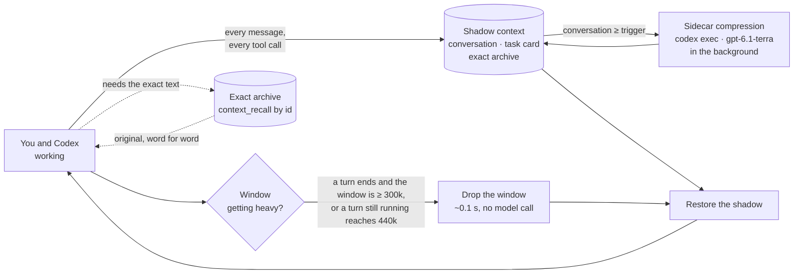
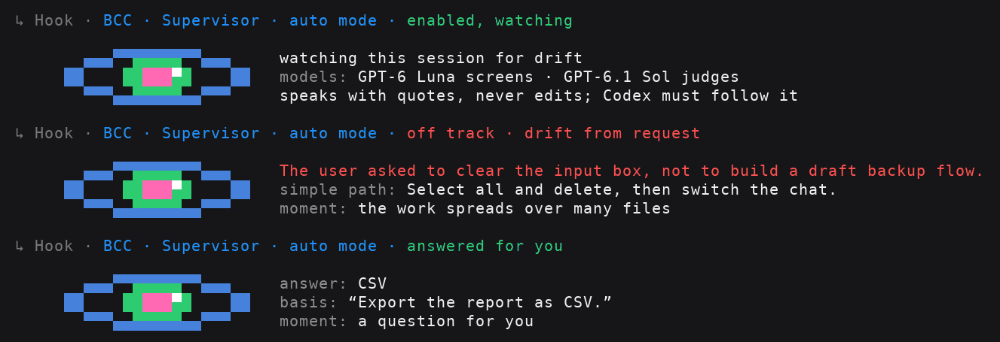

<div align="center">

# Better Codex Context

### Shadow context replacement for Codex CLI

**Long sessions that stay fast, stay on goal, and never forget what you said.<br/>A plugin. Nothing in Codex is patched.**

[](LICENSE)
[](pyproject.toml)
[](#compatibility)
[](pyproject.toml)
[](https://github.com/mathline-io/better-codex-context/actions/workflows/test.yml)

**English** · [简体中文](README.zh-CN.md)

</div>

---

> **In large projects and long-running tasks, Better Codex Context sharply reduces the three
> failures that hurt Codex most: scattered attention, losing track of the task, and death loops
> that burn tokens without making progress.**
>
> **Codex's own slow compaction practically never runs again.** In our logs it took a median of
> 133 seconds while the session waited. The replacement takes about 0.1 seconds, and compression
> happens on the side, so you hardly notice any pause.

## The idea

Codex keeps your whole conversation in its context window and only cleans up when it is about 95%
full. Until then every log, screenshot and "ok" stays in it, each step gets slower, and what you
actually asked for gets harder to see. Better Codex Context does **shadow context replacement**:

1. **Keep a shadow.** Next to the real window the plugin keeps a *shadow context*: the conversation
   (your messages, the answers, one line per tool call), a structured task card (goal, standing
   rules, tasks, lessons, files in play) and an exact archive of every message and output.
2. **Keep it compact, on the side.** A separate `codex exec` process condenses the shadow's
   conversation in the background (*sidecar compression*). The session never waits for it.
3. **Swap at the right moment.** When the real window gets heavy it is dropped without a model call
   and the shadow takes its place. Not a word you said is lost.
4. **Pull originals back on demand.** Whenever Codex needs the exact text behind a summary, it calls
   the plugin's MCP tool **`better_context.context_recall`** by itself with the id shown in the
   shadow (`⟦m17⟧`, `R0042`, `T7`) and gets the original back word for word.



## Why it works

**What an agent needs to *remember* is small; what it needs to *look up* is huge.** Plain Codex
keeps both in the window and pays for it on every request. The plugin puts what to remember on a
task card the model always sees, and what to look up in an archive it reads on demand.

- **Built as you go.** Four hooks see every message and tool result as it happens. Messages are
  sorted by fixed rules, with no model call: a new task, a standing rule ("from now on always…"), a
  correction, a repeat, an "ok". So the shadow is always current and swapping costs nothing extra.
- **A free swap.** The plugin turns on Codex's own TokenBudget mode, whose reset rebuilds the window
  without calling the model (about 0.1 s), and a hook puts the shadow back right after.
- **The right moment.** A *turn* runs from your message to Codex's answer. The window is swapped when
  a turn ends with **300k tokens or more** in it (Codex is waiting for you, so nothing is cut in half;
  the next turn starts at 30–40k), and, as a safety net, when a turn still running reaches **440k**
  (about one turn in 25). A small window is never swapped.
- **Rules enforced where they apply.** A standing rule can name the files it covers. The moment Codex
  changes one of them, the plugin hands it that rule and asks it to check the change.
- **Every change keeps its reason.** Right after each change Codex writes a short
  [change note](#change-notes), repeated in every fresh window.
- **Built into plan mode.** The plan, your answers and every step's status carry through approval
  and every reset ([Plan mode and the task lifecycle](#plan-mode-and-the-task-lifecycle)).
- **Key documents stay in view.** Architecture notes, contracts and ADRs Codex reads are listed with
  their live version status.
- **`AGENTS.md` that fits.** The rules beyond Codex's 32 KiB limit come back in every fresh window.
- **Loops get interrupted.** The same failure after every fix (however the test is invoked, wherever
  the line numbers move) escalates from a warning on the 2nd run to "rethink the cause" on the 3rd
  and "stop and tell the user" on the 5th; the same output three times in a row is called out too.
- **Auditable, visible, no dependencies.** `bcc verify` checks a session's invariants, every action
  prints a short line in your terminal, and it is Python's standard library only. Codex's binary,
  its files and your session logs are never modified.

## What it fixes

Measured on 18 real long-running sessions (1.6 GB of Codex logs); the method is in
[docs/design.md](docs/design.md), and `scripts/rollout_metrics.py` runs it on your own sessions.

| Problem | Plain Codex, measured | With Better Codex Context |
| --- | --- | --- |
| 🐢 **Slower the longer you work** | 5–8 s per request below 50k tokens, **21–26 s above 400k**; 42–86% of requests ran on a window more than half full | A turn that ends at 300k or more is followed by a fresh, small window |
| 📚 **Redundant context** | After one cleanup Codex still kept 339 user messages word for word: 28 screenshots (~10 MB), duplicates, bot messages, 76 one-word replies | Only the shadow comes back, capped to a share of the window |
| 🗂️ **Messy task management** | Hundreds of flat messages, no record of what is done or open | A task card with statuses; "done" needs a note on what was verified |
| 🧭 **Lost goals** | 6–16% of messages were corrections; in one project **51 of 60 `AGENTS.md` sections** never reached the model | Goal and standing rules on top of the card; the cut part of `AGENTS.md` is restored |
| 🔥 **Death loops** | After a cleanup **41–72%** of file reads re-read files; 6–33% of commands were exact repeats | The loop guard, lessons that keep rejected approaches rejected, files marked *unchanged since last seen*, and an `ATTENTION!` line in every fresh window: find the root cause before coding |
| ✂️ **Long output lost** | Output is cut at ~12k tokens; one session lost ~37.8M tokens of it | Every output is archived and read back with `context_recall` |
| ⏳ **Compaction stalls** | Median **133 s** per compaction, 62% over two minutes (178 compactions) | About **0.1 s**, no model call; condensing runs in the background |

Tokens actually sent per request, from real session logs (model with a 475k window):

| Mode | Requests | Sent per request (average) | Uncached per request |
| --- | --- | --- | --- |
| Native Codex (5 sessions) | 19,554 | 238k | 3.1–3.3k |
| Better Codex Context (2 sessions) | 2,173 | **163k (−32%)** | 2.6–3.1k |
| Better Codex Context, best session | 1,084 | **113k (−53%)** | 2.6k |

## Sidecar compression

The shadow's conversation (heavy tool output does not count) is condensed by a separate
`codex exec` process running **gpt-6.1-terra** at medium effort, with your existing Codex login.
The first run starts at 80k tokens, later ones when the conversation has grown to three times the
last result (two times above 120k), always between 60k and 160k. On a real session it turned 67k
tokens into 1.6k in 43 seconds while the session kept working.

- **Never in the way.** It runs detached, and a replacement never waits: it uses the latest finished
  result, and anything newer stays word for word. A result that is invalid, loses open items or is
  not clearly smaller is discarded.
- **Kind to the cache.** Results enter only at the next replacement, so every request inside a window
  reuses its cached prefix. The first request after a replacement processes the shadow afresh (41–58%
  cache hits instead of 92–95%), one more reason the plugin waits for 300k.
- **Off switch.** `sidecar = "off"` means no model calls; the shadow is then restored from rule-based
  excerpts. `shadow_mode = "card"` restores only the task card.

**Evidence summaries.** When a turn ends, its evidence is summarized in one background `codex exec`
run with **GPT-6 Luna** at high effort, about 600 tokens per unit. A unit is a tool output of 3k tokens or
more, a screenshot, or a *step* of smaller outputs that add up to 8k: consecutive tool calls with no
message of the model or the user between them (measured on real sessions: 8 outputs in a typical step,
22 at most). Each summary gives the result in one line, the findings (hypotheses marked unverified), the decisive
lines as evidence `E1`, `E2` …, and a next step. Every quoted line is looked up in the original and
kept only when found, with its position, so the model can open it with
`context_recall(ref="m12", start=1834)`. Restored windows show these summaries instead of rule-based
excerpts (a step's summary once, after its last output); the originals stay archived. Simulated on 20
real sessions, that is about 1.7M input and 180k output tokens of GPT-6 Luna per session, about $0.26 at
API prices or 0.5% of what the session itself costs on GPT-6.1 Sol. The summaries are part
of the shadow: sidecar compression is asked to keep them, and every restored window lists those of the
summarized part word for word. A summary that finishes after its window was replaced (a run takes 5–20 s)
is added at the next prompt or tool call. `evidence = "off"` saves these tokens, but restored windows
then show earlier evidence only as excerpts; `context_recall` still returns every original.

## Change notes

A replaced window keeps the conversation and short excerpts, not every diff. Yet what a later window
most needs about a change is its purpose. So right after each change Codex writes a short note in its
next message, which the terminal shows as a small list:

```markdown
**BCC Change note** · T3 · 2026-11-09 15:20:33 UTC · `src/auth/session.py`, `src/auth/token.py`
- **Symbols:** add `Session.refresh`; edit `load_config`, `SESSION_TTL`; del `legacy_ttl`
- **Motive:** sessions expired after 30 s instead of 10 min
- **Reason:** the timeout was read in seconds but stored in ms; converting at the boundary keeps the API
- **Risk:** tokens issued before the fix keep the old expiry
- **Tests:** needed: an expiry test across a restart
```

Each note names the classes, methods, functions and variables it changed, marked add, edit or del, so a
deleted function is still found later (never line numbers, which shift with the next edit), and carries the current UTC time, so a later window can find the code and tell when a
change was made, to compare it with commits or logs. The plugin records it as `K1`, `K2` … at the next tool call, while the turn runs, and every fresh
window gets the newest notes in full and older ones as ids; each edited file points at its note.
The first file change of a turn reminds Codex to end its answer with the note (`change_notes`),
and the first patch that adds a dozen or more lines of code without a comment reminds it to comment
them while it writes (`code_comments`). A finished turn is never held to add notes or comments
afterwards.

## Skills after a replacement

Codex rebuilds its list of skills in every new window, but not the text the model read: a skill read earlier is
gone with the old conversation. Re-reading is often partial too: Codex cuts long output (keeping its head and
tail), so a cut skill reads like the whole one.

- **Resident skills** (the coding discipline, `context-discipline`) go word for word into every new window and
  are never shortened; when space is short, the restored conversation gives way instead.
- **Skills used once** (making a deck) are not brought back: Codex reads them again when it needs them. After a
  replacement the window never shows an excerpt or a summary of them, only that they must be read again in full.
- **A skill read in part** is flagged at once: when the output lacks part of the file, Codex is told to read the
  rest before following it.

Which skills are resident: `resident_skills` (see Configuration).

## Plan mode and the task lifecycle

BCC works with Codex's own plan mode instead of beside it: the plan you approve, the answers you gave
while planning and the status of every step stay with the session through approval, fresh contexts
and every window replacement.

**For complex systems and long-running tasks, start in plan mode.** The longer the work runs, the
more windows it passes through, and the plan of record is what keeps every one of them aimed at the
same target: it comes back word for word after each replacement, your decisions stay standing rules,
and each step carries its own status, so the work neither drifts nor quietly skips a step.

1. **Plan.** Type `/plan` and describe the goal. Codex explores read-only and may ask you questions;
   each answer is recorded on the task card as a standing decision (`Decision: question → answer`).
2. **Review.** Codex ends with its plan. BCC keeps it word for word as the plan of record `P1` and says
   so in the terminal (`Plan recorded`). Ask for changes as often as you like: a revised plan becomes
   `P2` and replaces `P1`. Every fresh window restores the latest plan in full.
3. **Approve.** Choose *Yes, implement this plan* to keep the current window, or *Yes, clear context and
   implement* to start a fresh thread with the plan as its first message. Either way the task card
   gets one task for the plan and one task per step (each top-level list item; sections such as the
   summary or the assumptions describe and stay with the plan's task):
   ```text
   T1 [in_progress · 2026-11-09 08:12:40 UTC] Implement plan P1: Inventory reservations
   T2 [pending] (step of P1) **Baseline**: record owners, live services and test evidence
   T3 [pending] (step of P1) **Migration**: verify 0066 on a copy of the production data
   ```
4. **Implement.** Codex is back in its default mode, so the *Plan mode* label disappears; that is
   expected. While Codex is working, `/plan` is refused (`'/plan' is disabled while a task is in
   progress`): wait for the turn to end or press Esc, then `/plan` again.

**The task lifecycle.** A task is `pending` until work starts: the plan's task (or the task of your
message) moves to `in_progress` at the first real tool call, a step when Codex reaches it. Codex sets
`needs_verification` when a change is made but not yet checked, `blocked` with what blocks it, and
`done` only with a note on what it verified; a request of yours is only withdrawn
(`cancelled`, `superseded`) by a later message from you. Statuses a turn left unset after working are
asked for with your next message; the finished turn is never held for them. Every change is stamped in UTC, the card shows each
task's latest one, and `context_recall("T3")` lists a task's whole history. Change notes name the
task they serve.

Keep the steps of a plan as top-level list items: each becomes a task of its own. A message you type
or paste yourself stays one request however many lines it has; ask Codex to split it on the card if
you want separate tasks.

**Changing course.** Run `/plan` again in the middle of the work and approve the new plan in the same
thread: the old plan's open tasks are superseded, a step the new plan repeats keeps its state (a step
done earlier is not redone), and your planning request joins the new plan's task. If you tell Codex
to stop because the work went off track ("stop, this drifted, start over"), in plan mode or not, BCC
treats it as a change of direction rather than a correction: the old plan no longer counts as the plan
to follow, and Codex has to decide each open task from before (cancel, supersede, or keep it with a
reason). Old checkpoints, change notes and failing commands are marked as predating the change, so a
fresh window doesn't steer back to the abandoned approach.

**When you're unhappy with the work.** BCC also reads your feedback. If you complain hard ("how many
times do I have to say this", anger at the work) or raise the same problem again and again ("still
not working" twice, or three times in other words), it treats that as drift: Codex is told to stop
the current approach, re-read what you asked, name the root cause instead of trying one more quick
fix, record it as a lesson, and present a revised plan (or do exactly what you said, if you said
it). Your own words count, not pasted logs or code.

## The supervisor (optional)



A second model can watch the session for you. Cheap rules pick the moments worth a look: the work
spreading over many files, many steps without a change, the same command again, a long run since your
request, a claim of success, a question for you, a turn that ends while its work is still open.
GPT-6 Luna screens each one strictly and passes only what it can pin to a quoted line; GPT-6.1 Sol then
judges an excerpt from where you stand: the simple path to what you asked, the feature first, no
guarding against cases that cannot happen. It never edits files and always quotes its evidence. It manages
the session for you: Codex must follow its findings; only your own explicit words rank above them.

- `advise`: reviews run in the background, and a finding reaches Codex at its next step.
- `auto`: fully automatic. When a turn ends with a question for you or with its work still open, the
  supervisor reviews and Codex goes on with its finding, or with its answer to the question when the
  answer is known (most of the time you take Codex's recommended option anyway). Only what it cannot
  know comes to you: something only you can see or do, a secret, or a step with real consequences you
  haven't asked for. Its answers stand on the task card as decisions you can undo.
- **Open tasks** (both modes): when a turn ends with tasks still open on the card, GPT-6 Luna checks
  each against the conversation (really unfinished, or done but not ticked, cancelled, waiting for you?)
  and passes only real ones to GPT-6.1 Sol, which lists what is left, the steps that finish it and a
  firm restart prompt. The same open tasks are reviewed at most twice.
- **Waking Codex** (`auto`): where the session runs in Codex's local daemon (the CLI on Linux and macOS),
  the turn ends at once, the review runs in the background, and a finding wakes Codex with
  `codex queue --resume` and a message that starts with `[BCC supervisor]` (filed as the supervisor's,
  not as your words). Elsewhere (Windows, VS Code) the end of the turn is held for the review instead.
- **Messages from other Codex tasks**: a message another Codex task sends this one (`send_message_to_thread`,
  `codex queue`) arrives looking like yours. The plugin tells them apart by the message id your Codex client sets,
  so such a message is shown as the other task's and never becomes a task of yours on the card.

Replayed on 82 real sessions, it caught an agent over-building a small fix (backups and content checks
nobody asked for) 13 minutes before the user said "you don't need to make it this complicated", and
spotted turns that ended with work still open, each time with one specific message for the agent. A
review costs well under a cent for the screen and about $0.03 when Sol judges it (it reads an excerpt,
about 1,700 tokens, instead of the whole transcript). It is off by default.
When a session starts on an engineering project or a complex request, Codex offers it once and asks which mode you
want. You can also just say so in your own words ("turn on the supervisor", "全自动监督"); if you don't name a mode,
Codex asks. "Don't ask again" stops the offers (`supervisor_offer = "off"`).

## Install

You need Codex CLI **0.166 or newer** or the Codex extension for VS Code, and Python **3.11+**, on
Linux, macOS or Windows.

```bash
git clone https://github.com/mathline-io/better-codex-context.git
cd better-codex-context
python3 scripts/launch.py install
python3 scripts/launch.py doctor      # read-only health check
```

`install` sets up **every Codex on the machine**: the CLI on your PATH and the Codex bundled with the
VS Code extension. For each one it installs the plugin, trusts its four hooks (after checking they are
exactly the plugin's own), turns on the reset settings and tells a running Codex to reload. An
existing **Mathline Research** marketplace is joined, not replaced. Keep the checkout where it is:
the hooks run from its `dist/` directory.

**Windows (PowerShell):** run the same commands with `python` instead of `python3`, then fully restart
Codex (Windows has no way to tell a running Codex to reload). To set up only one Codex, name it:
`python scripts/launch.py install --codex (Get-Command codex.exe).Source`.

**VS Code:** the same `install` finds the extension's bundled Codex under `~/.vscode/extensions`
(also `~/.vscode-server` for Remote-SSH, where you run it on the remote machine, and
`~/.vscode-insiders`). Then run **Developer: Reload Window**. BCC's lines appear under an answer's
**Hook stats** menu, as plain text. Run `install` again after the extension updates.

Optional: `python3 -m pip install -e .` adds the `bcc` command. Token counts need nothing extra: the plugin
counts every token itself with o200k_base, built in (tiktoken's algorithm, ported to plain Python).

## Using it

Use Codex as you always do. In the background:

| When | The plugin |
| --- | --- |
| You send a message | Saves it word for word, gives each paragraph an id (`R0012`) and puts it on the task card |
| A tool runs | Archives the output and updates the working set (files, versions, failing commands) |
| Codex starts on your request | Marks its task `in_progress`; statuses a working turn left unset are asked for with your next message |
| Codex changes a file a standing rule covers | Hands it that rule and asks it to check the change |
| A turn ends with ≥ 300k tokens in the window | Codex saves the card, the window is replaced in about 0.1 s and the shadow restored |
| The model goes in circles | Warns on the 2nd identical failure, asks to rethink on the 3rd, to stop on the 5th |

Every action prints a short line as it happens (title in tech blue, details in grey), and each turn
ends with the session's tokens: input in orange with its cached share in green, output in pink, and
how full the window is, then on a line of its own what the evidence summaries used of GPT-6 Luna.

```text
› Fix the login timeout. From now on, always run the tests before committing.
↳ Hook · BCC · Organized your message onto the task card (R0001–R0002): T1 task, C1 standing rule
↳ Hook · BCC · Failing command noted (exit 1): pytest -q
↳ Hook · BCC · Edit recorded: src/auth/session.py
↳ Hook · BCC · Loop guard: `pytest -q` failed 3× in a row with the same error; asked the model to change approach
↳ Hook · BCC · Change note recorded: K1 for `src/auth/session.py` (task T1); restored in every fresh window
↳ Hook · BCC · Shadow context optimized in the background: 81.2k → 1.6k; next at 60.0k
↳ Hook · BCC · Session tokens: 170.7M in (98.1% cached, 3.2M uncached) · 931k out (431k reasoning) · context 291k of 475k (61%)
  BCC · Evidence tokens: 1.7M in · 180k out (2.3k reasoning) · 22 runs · GPT-6 Luna
• Blocked by hook
  └ BCC · Routine follow-up, not an error: the turn continues once for what is listed below
  BCC · Turn finished with about 312k tokens in the window: optimizing the context for the next request
• Context compacted · 0s
↳ Hook · BCC · Context optimized: fresh window with the shadow context and the task card (1 rule, 0 open tasks, 1 lesson)
```

"Blocked by hook" and "Context compacted" are Codex's own labels and can't be changed. Set
`activity_log = "verbose"` for more detail, `"off"` for silence.

After every swap the model sees a card like this (real output, shortened):

```text
Goal: Move the order panel to the new chart component without changing order placement
Current focus: T4 inertial scroll snap-back
Standing constraints (always apply):
C1 [active] Order placement must not change. ⟨R0002⟩
C2 [active] (user repeated ×1) Always reproduce a bug in the browser before fixing it. ⟨R0003, R0008⟩
In progress / needs verification / blocked:
T4 [in_progress · 2026-11-09 14:52:10 UTC] (user correction re T3) Still broken: clicking during inertial scroll snaps back. ⟨R0007⟩
Lessons (root causes and rejected approaches; do not regress):
L1 [active] Misalignment came from two coordinate conversions; both now use scale.ts
Closed:
T2 [done · 2026-11-09 14:31:47 UTC] The indicator pane is misaligned with the main chart. ⟨R0005⟩
   Status/verification scope: panes aligned in browser at 3 zoom levels; mobile not checked
```

Each task shows the UTC time of its latest status change, in the same form as change notes, and
`recall T4` lists its whole status history.

### Commands

`python3 scripts/launch.py <command>` (or `bcc <command>`). Session commands take `--session ID`,
the UUID at the end of `~/.codex/sessions/…/rollout-…-<id>.jsonl`.

| Command | What it does |
| --- | --- |
| `install` / `upgrade` | Build, install, trust the hooks, apply settings, reload the running Codex |
| `doctor` | Read-only health check: Codex version, settings, hook failures, `AGENTS.md` size |
| `card` / `shadow --session ID` | Print the task card, or the shadow a replacement would restore now |
| `recall REF --session ID` | Print an archived original (`R0009`, `T3`, an archive id) |
| `verify --session ID` | Check ledger, card links, rules, archive and hooks (exit code 1 on a broken invariant) |
| `reload` | Make a running Codex re-read its config and plugins |

Codex calls the plugin's three MCP tools by itself: `context_recall` (originals by id, or search),
`context_state` (read and update the task card, settings) and `context_material` (capture and diff
files).

## Configuration

The easiest way is to ask Codex: "what can BCC be set to do?" or "set the replacement threshold to
200k". It reads and changes the settings through the plugin's own tool, checked against the allowed
values. Or edit `~/.config/better-codex-context/config.toml`; changes apply from the next hook run.
The most useful ones:

```toml
idle_reset_tokens = 300000    # replace the window when a turn ends with at least this many tokens; 0 = never
card_budget       = 3500      # size of the restored task card, in tokens
loop_guard        = 3         # warn at 2, rethink at 3, stop at 5; 0 = off
activity_log      = "normal"  # terminal lines: "normal", "verbose" or "off"
change_notes      = "require" # "require", "ask" or "off"; code_comments works alike
sidecar           = "auto"    # sidecar compression; "off" = no model calls
sidecar_model     = "gpt-6.1-terra"
evidence          = "auto"    # summaries of large outputs and screenshots; "off" saves their tokens, but restored
                              # windows then show only excerpts of earlier evidence (originals stay recallable)
evidence_model    = "gpt-6-luna"
supervisor        = "off"     # "advise" or "auto": a second model watches for drift (see The supervisor)
resident_skills   = ["context-discipline"]  # skills kept whole in every new window; [] = none
```

`doctor` lists every setting with its value. Each can also be set as `BCC_<NAME>` in the environment
Codex starts from.

`install` also turns on Codex's TokenBudget mode in `~/.codex/config.toml` and writes
`model_auto_compact_token_limit = 440000` with a `BCC-MANAGED` comment above it. Your own values for
the other keys survive every reinstall; to keep your own limit too, change the number and delete the
`BCC-MANAGED` marker. On a model with a 258k window set that limit to `230000`; the end-of-turn
threshold scales down by itself.

**Using Codex with an API key? Lower the threshold to 265k. With a ChatGPT subscription you don't need
to change anything.** With an API key, OpenAI bills a request whose input exceeds 272K tokens at the
long-context rate for the whole request: input and cached input cost twice as much, output 1.5 times.
Codex signed in with a ChatGPT subscription has no such surcharge, so keep the default of 300k there.
With an API key, set `idle_reset_tokens = 265000` (or ask Codex to):
a turn that ends above it is replaced, so the next turn starts small instead of paying the long-context
rate on every request. It costs little: a few more replacements, each a second or two of extra
requests. A long turn can still pass 272K before it ends; only lowering `model_auto_compact_token_limit`
as well prevents that, at the price of replacements in the middle of a turn.

Everything stays on your machine: each project's state lives in `<project>/.better-codex-context/`
(with its own `.gitignore`), the hook error log in `~/.local/state/better-codex-context/`. The only
data that leaves it is what sidecar compression and evidence summaries send to your own Codex account
(the same service Codex itself talks to).

## Upgrade and uninstall

```bash
git pull && python3 scripts/launch.py upgrade
```

To uninstall, run `codex plugin remove better-codex-context@mathline-research` and
`codex plugin marketplace remove mathline-research`, then set `features.token_budget.enabled = false`
in `~/.codex/config.toml`.

## Compatibility

| Codex | Status |
| --- | --- |
| **0.167.0**, **0.166.0** | ✅ Verified end to end |
| 0.164.0-alpha.11.1 (bundled with the VS Code extension) | ✅ Verified end to end, run as the extension |
| Newer versions | Expected to work; check with `scripts/e2e_smoke.py`. The plugin warns when it runs on an unverified Codex |
| Older than 0.164 | Not supported (no plugin hooks) |

"Verified end to end" means `scripts/e2e_smoke.py` passes all 26 checks against the real Codex binary
over three turns and two replacements, with a local stand-in model (no paid requests). Linux is
verified end to end; macOS and Windows run the full unit test suite in CI.

## FAQ

<details>
<summary><b>Will it ever drop something I said?</b></summary>

No. Every paragraph keeps its id and exact words in the archive, a request can only be withdrawn by a
later message of yours, and `context_recall("R0042")` always returns the original.
</details>

<details>
<summary><b>Does it cost extra tokens?</b></summary>

About 1k tokens per request for the tool definitions, and one or two short extra requests per
replacement, whose first request processes the shadow without cache. In exchange the turns after it
run in a much smaller window: over a long session the plugin sends far fewer tokens (see above).
Sidecar compression and evidence summaries count against your Codex plan: compression about once per
60k tokens of new conversation, evidence summaries about 1.7M input and 180k output tokens of GPT-6
Luna per long session. `doctor` shows what both used.
</details>

<details>
<summary><b>Can the loop guard get in the way?</b></summary>

It only speaks when the same command fails the same way after a fix with no progress, or returns the
identical output three times with nothing changed. Replayed over 27,336 real tool calls it spoke
7 times, each on a real retry loop. It never blocks or undoes anything; `loop_guard = 0` turns it off.
</details>

<details>
<summary><b>A hook failed, or says "No such file or directory" after an upgrade</b></summary>

Hooks never break your session: a failure shows as a one-line warning, and the traceback goes to
`~/.local/state/better-codex-context/hook-errors.log` (`doctor` lists recent ones). After an upgrade, a
Codex started earlier still points at the old plugin: run `bcc reload`, or **Developer: Reload Window**
in VS Code.
</details>

## Development

```bash
PYTHONPATH=src python3 -m unittest discover -s tests      # unit tests
python3 scripts/e2e_smoke.py "$(command -v codex)"         # real Codex, stand-in model, no paid requests
```

Please read [AGENTS.md](AGENTS.md), the rules every change must keep, and [docs/design.md](docs/design.md).

## Contact

Questions, feedback and collaboration: [richard@mathline.io](mailto:richard@mathline.io)

## License

[Apache License 2.0](LICENSE) © 2026 [Mathline Research](https://mathline.io). See [NOTICE](NOTICE).
