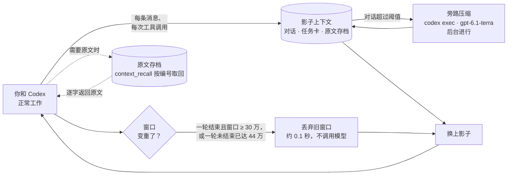
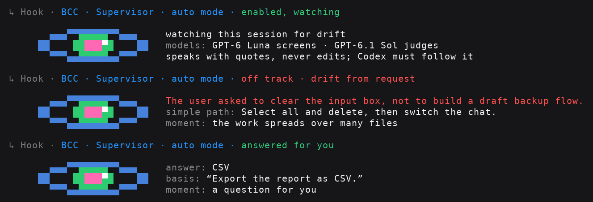

<div align="center">

# Better Codex Context

### 为 Codex CLI 打造的「影子上下文替换」

**让长会话保持流畅、专注，并保留重要信息。<br/>以插件方式运行，无需修改 Codex 源码。**

[](LICENSE)
[](pyproject.toml)
[](#兼容性)
[](pyproject.toml)
[](https://github.com/mathline-io/better-codex-context/actions/workflows/test.yml)

[English](README.md) · **简体中文**

</div>

---

> **在大型项目和长期任务中，Better Codex Context 旨在缓解三个常见问题：上下文过长导致注意力分散、
> 工作偏离目标，以及重复尝试消耗大量 token。**
>
> **安装后，Codex 原生压缩触发的次数将大幅减少。** 原生压缩每次都要让会话停下来等模型写摘要，
> 中位数 133 秒；插件替换窗口只需约 0.1 秒，压缩又放在旁路后台进行，几乎察觉不到停顿。

## 核心思路

Codex 把整段对话都放在上下文窗口里，要等到快满（约 95%）才清理一次。在那之前，每一段日志、每一张截图、
每一句“好的”都会占用空间。随着会话增长，请求处理可能变慢，模型也更难把握你的目标。
BCC 采用另一种方式，称为**影子上下文替换**：

1. **同步维护一份“影子”。** 插件在真实窗口之外同步维护一份影子上下文：对话本身（你的消息、Codex 的回复、
   每次工具调用记一行）、一张结构化的任务卡（目标、你设定的约束、待办事项、经验教训、正在处理的文件），以及所有
   消息和输出的原文存档。
2. **在后台压缩影子。** 独立的 `codex exec` 进程在后台压缩影子对话，称为**旁路压缩**；主会话不必等待。
3. **在合适的时机替换窗口。** 真实窗口达到替换条件时，插件不调用模型，直接用影子重建上下文。你的消息原文仍保存在存档中。
4. **需要原文时随时取回。** Codex 需要摘要背后的原文时，会**自动调用**插件的 MCP 工具
   **`better_context.context_recall`**，按影子里标注的编号（`⟦m17⟧`、`R0042`、`T7`）逐字取回。



## 为什么行得通

**智能体需要“记住”的很少，需要“查阅”的很多。** 原生 Codex 将两者都放在窗口里，每次请求都要处理其中的内容。
插件将两者分开：需要持续关注的信息放在任务卡中；需要时才查阅的内容放入存档。

- **边工作边记录。** 四个钩子在消息和工具调用发生时收集内容，并按固定规则分类，无需额外调用模型：
  包括新任务、长期约束（“以后都要……”）、纠正、重复要求和简单回复。影子随会话持续更新，替换时无需临时整理。
- **替换几乎零成本。** 插件开启 Codex 自带的 TokenBudget 模式，重建窗口时不调用模型（约 0.1 秒），钩子随即把影子放回去。
- **时机有讲究。** “一轮”指从你发出一条消息到 Codex 回复完毕。一轮结束、且窗口已达 **30 万 token** 时替换：
  这时 Codex 正等你的下一条消息，什么都不会被打断，下一轮从三四万 token 重新起步；一轮还没结束窗口就涨到
  **44 万**时，由 Codex 原生机制兜底（约每 25 轮才有 1 轮走到这一步）。窗口不大时从不替换。
- **在相关文件上检查约束。** 长期约束可以指定适用的文件。Codex 修改这些文件时，插件会提醒它依据相关约束检查改动。
- **每处改动都留下理由。** Codex 每完成一处改动，就当场写一段简短的[改动说明](#改动说明)，每个新窗口都会重申。
- **和计划模式深度整合。** 计划、你在规划时的回答、每一步的状态，在批准、清空上下文和每次替换之后都不会丢
  （见[计划模式与任务生命周期](#计划模式与任务生命周期)）。
- **关键文档始终在视野里。** 模型读过的架构说明、接口契约、ADR 会列出实时版本状态。
- **`AGENTS.md` 再长也不会被忽略。** 超出 Codex 32 KiB 上限的规矩，每个新窗口都会补回来。
- **发现重复尝试时提醒。** 修改后仍出现相同失败（不受测试命令写法或行号变化影响）：第 2 次警告，第 3 次要求换思路，
  第 5 次要求停下并告诉用户；同样的结果连续出现三次也会叫停。
- **可自检、过程透明、零依赖。** `bcc verify` 检查会话状态的各项不变量；插件每做一件事都在终端打印一行；仅使用
  Python 标准库，不修改 Codex 程序、内置文件或会话日志。

## 解决了哪些问题

我们分析了 18 个真实的长会话（共 1.6 GB 的 Codex 日志），方法见 [docs/design.md](docs/design.md)；用
`scripts/rollout_metrics.py` 可以在你自己的会话上做同样的分析。

| 问题 | 原生 Codex 的实测情况 | 用上 Better Codex Context 之后 |
| --- | --- | --- |
| 🐢 **越用越慢** | 窗口不到 5 万 token 时每次请求 5–8 秒，**超过 40 万时 21–26 秒**；42%–86% 的请求是在窗口过半时发出的 | 一轮结束时窗口达到 30 万 token，下一轮便使用替换后的较小窗口 |
| 📚 **上下文冗余** | 一次清理后仍逐字保留了 339 条用户消息：28 张截图（约 10 MB）、重复消息、机器通知、76 条一两个字的回复 | 只带回影子，总量按窗口比例封顶 |
| 🗂️ **任务管理混乱** | 几百条消息平铺在一起，做完了什么、还剩什么都没有记录 | 任务卡上每一项都有状态，标“完成”必须写明验证了什么 |
| 🧭 **抓不住任务重心** | 6%–16% 的消息是在纠正 Codex；有个项目 `AGENTS.md` 的 **60 个章节里有 51 个**模型从未见过 | 目标和长期规矩始终在任务卡最上方，`AGENTS.md` 被截掉的部分会补回来 |
| 🔥 **死循环白烧 token** | 清理之后 **41%–72%** 的文件读取是在重读；6%–33% 的命令原样重跑 | 循环守卫叫停；经验记录帮助避免重复采用已否决的方案；没改动的文件会被标出；每个新窗口末尾一句 `ATTENTION!`：动手前先查清根因 |
| ✂️ **长输出找不回来** | 单次输出超过约 1.2 万 token 就被截断，一个会话里约 3780 万 token 就此丢失 | 每次输出都完整存档，用 `context_recall` 逐字取回 |
| ⏳ **压缩时整个流程卡住** | 每次压缩中位数 **133 秒**，六成以上超过两分钟（统计 178 次） | 约 **0.1 秒**完成替换，不调用模型；压缩在后台进行 |

真实会话日志中，每次请求实际发送给模型的 token 数（模型窗口 47.5 万）：

| 模式 | 请求数 | 平均每个请求发送 | 平均每个请求未命中缓存 |
| --- | --- | --- | --- |
| 原生 Codex（5 个会话） | 19554 | 23.8 万 | 3100–3300 |
| Better Codex Context（2 个会话） | 2173 | **16.3 万（少 32%）** | 2600–3100 |
| Better Codex Context，最好的一个会话 | 1084 | **11.3 万（少 53%）** | 2600 |

## 旁路压缩

影子里的对话部分（大块的工具输出不计入）由一个独立的 `codex exec` 进程压缩，使用 **gpt-6.1-terra**、推理强度
medium，沿用你现有的 Codex 登录。对话首次达到 8 万 token 时压缩，此后每当涨到上次结果的 3 倍时再压（阈值超过
12 万后改为 2 倍），阈值始终在 6 万到 16 万之间。在一个真实会话上，约 6.7 万 token 的对话 43 秒压成约 1600 token，
主会话全程照常工作。

- **不打扰主会话。** 压缩进程独立运行，替换从不等它：只用已经完成的最新结果，之后新增的对话原样保留。如果结果格式不正确、遗漏未完成事项或压缩效果不明显，
  就会被丢弃。
- **便于复用缓存。** 压缩结果只在下一次替换时进入新窗口，所以同一个窗口里的每个请求都能复用缓存。替换后的第一个
  请求要重新处理影子（命中率 41%–58%，平时 92%–95%），这也是插件等到 30 万才替换的原因之一。
- **随时可以关闭。** 设 `sidecar = "off"` 后不再调用任何模型，影子改用规则摘录恢复；设 `shadow_mode = "card"` 则只恢复任务卡。

**证据摘要。** 每一轮结束时，这一轮的证据会合在一起，交给一个后台的 `codex exec`，用 **GPT-6 Luna**、推理强度 high
提炼，每个单元约 600 token。一个单元是：一份 3k token 以上的工具输出、一张截图，或者一个由较小输出组成、合计达到 8k 的
**步骤**，也就是中间没有模型说明、也没有用户消息的一串连续工具调用（真实会话里一个步骤通常 8 次调用，最多 22 次）。
每份摘要包括：一句话结论、关键发现（推测会标明未验证）、作为证据的关键原文
`E1`、`E2`……，以及建议的下一步。每条引文都会回到原文里核对，找得到才保留，并附上位置，模型可以用
`context_recall(ref="m12", start=1834)` 直接跳到那一处。替换后的新窗口里，这些输出显示摘要而不是规则摘录，原文仍完整存档。
一个步骤的摘要只在它最后一次调用下面显示一次。按 20 个真实会话模拟，平均每个会话约用 GPT-6 Luna 170 万输入、
18 万输出 token，按 API 价格约 $0.26，相当于会话本身用 GPT-6.1 Sol 费用的 0.5%。
证据摘要也是影子的一部分：旁路压缩会被要求保留它们，每次替换后的新窗口还会把被压进总结那部分的证据摘要原样列出。
一次提炼要 5–20 秒，如果摘要在窗口替换之后才完成，会在下一条消息或下一次工具调用时补给模型。设 `evidence = "off"`
可以省下这部分 token，但替换后的窗口里早期证据只剩规则摘录，模型对先前证据的了解会减少；原文仍然可以用
`context_recall` 取回。

## 改动说明

替换后的窗口保留的是对话和简短的摘录，不会保留每一处 diff。可后来的窗口最需要知道的，恰恰是一处改动的来龙去脉。
所以 Codex 每完成一处改动，就在接下来的消息里写一段简短的说明，终端里显示为一个小列表：

```markdown
**BCC Change note** · T3 · 2026-11-09 15:20:33 UTC · `src/auth/session.py`, `src/auth/token.py`
- **Symbols:** add `Session.refresh`; edit `load_config`, `SESSION_TTL`; del `legacy_ttl`
- **Motive:** sessions expired after 30 s instead of 10 min
- **Reason:** the timeout was read in seconds but stored in ms; converting at the boundary keeps the API
- **Risk:** tokens issued before the fix keep the old expiry
- **Tests:** needed: an expiry test across a restart
```

每段说明都列出改动过的类、方法、函数和变量名，并标明是新增（add）、修改（edit）还是删除（del），删掉的函数以后也能
查到是哪次删的（不写行号，行号下一次修改就变了），并带着当时的 UTC 时间，
之后的窗口能据此找到对应的代码，判断改动发生在什么时候，和提交记录、日志对照。
插件在下一次调用工具时就把它存为 `K1`、`K2`……，不必等一轮结束；每个新窗口都完整列出最近的说明，更早的折叠成
编号，改过的文件也标着对应的说明。一轮里第一次改文件时，插件会提醒 Codex 在这一轮的回答末尾写上说明（`change_notes`）；
第一次有补丁加了十几行以上代码却没有注释时，提醒它边写边补注释（`code_comments`）。一轮已经结束，就不会再拦着要求补写。

## 替换后的技能

每个新窗口里，Codex 都会重新列出可用技能，但模型读过的技能正文不会跟过来，会随旧对话一起丢掉。重新读取也常常不完整：
Codex 会截断过长的输出，只留开头和结尾，模型拿到被截断的技能，很容易当成全文。

- **常住技能**（编码规范，即 `context-discipline`）原文放进每个新窗口，从不压缩；窗口不够时，让步的是恢复的对话。
- **只用一次的技能**（比如做 PPT）不带回来，需要时 Codex 再读。替换后的窗口里也不会出现它们的片段或摘要，只写明
  要用就得重新读完整的 SKILL.md。
- **只读到一部分的技能**会被当场发现：输出里缺了文件的某一段，就提醒 Codex 先读完再照着做。

哪些技能是常住技能，由 `resident_skills` 决定（见“参数设置”）。

## 计划模式与任务生命周期

BCC 与 Codex 的原生计划模式集成，并增强任务生命周期管理。你批准的计划、规划时的回答和各步骤的执行进度，
都会在批准计划、清空上下文和窗口替换后保留下来。

**处理复杂系统或长期任务时，建议从计划模式开始。** 较长的任务可能经历多次窗口替换。计划记录让每个新窗口都能
看到同一个目标：替换后恢复计划原文，将你做出的决定作为持续有效的约束，并分别跟踪每一步的状态，
帮助工作保持在既定目标内，避免遗漏步骤。

1. **规划。** 输入 `/plan`，说明你的目标。Codex 会以只读方式查看代码，必要时向你提问；你的每个回答都会作为长期决定
   记到任务卡上（`Decision: 问题 → 回答`）。
2. **审阅。** Codex 最后给出计划，BCC 把它原文存为计划记录 `P1`，终端里会提示 `Plan recorded`。可以反复要求修改：
   修改后的计划存为 `P2`，取代 `P1`。每个新窗口都会完整恢复最新的计划。
3. **批准。** 选 *Yes, implement this plan* 会在当前窗口里继续执行；选 *Yes, clear context and implement* 会新开一个
   会话，把计划作为第一条消息。两种方式下，任务卡上都会生成一个计划任务，计划的每一步再各成一个任务（计划里的
   每个顶层列表项是一步；“概要”“假设”这类描述性小节不算步骤，归到计划任务下）：
   ```text
   T1 [in_progress · 2026-11-09 08:12:40 UTC] Implement plan P1: 库存预占整合
   T2 [pending] (step of P1) **盘点与基线**：记录事实所有者、运行服务和测试证据
   T3 [pending] (step of P1) **迁移验证**：在生产数据副本上验证 0066
   ```
4. **执行。** 这时 Codex 回到默认模式，右下角的 *Plan mode* 标记会消失，这是正常的。Codex 执行期间输入 `/plan`
   会被拒绝（`'/plan' is disabled while a task is in progress`）：等这一轮结束，或者按 Esc 中断后再输入 `/plan`。

**任务的生命周期。** 任务开始处理前处于 `pending`（待办）状态：计划任务（或者你那条消息对应的任务）在第一次真正
调用工具时自动变为 `in_progress`（进行中），各个步骤则在 Codex 做到时才开始。改完但还没验证的标 `needs_verification`，
卡住的标 `blocked` 并写明原因，`done`（完成）必须写明验证了什么；你提出的要求只有在你后来的消息明确撤回时才会变成
`cancelled` 或 `superseded`。一轮中完成了工作但未更新任务卡，会在你下一条消息时请 Codex 补上状态，已经结束的那一轮不会被拦。每次状态变化都记有 UTC 时间，任务卡
显示每个任务最近一次变化的时间，`context_recall("T3")` 可以看到完整的状态历史。每段改动说明也会写明它服务于哪个任务。

请将计划的每一步写成顶层列表项，这样每一步都会成为单独的任务。你自己输入或粘贴的消息，不管有多少行，都算一个请求；
需要拆成多个任务时，让 Codex 在任务卡上拆分即可。

**中途改方向。** 做到一半再 `/plan` 并在当前对话里批准新计划：旧计划没做完的任务会被标为已取代，新计划里一字不差
重复的步骤沿用原来的状态（已经做完的不会重做），你发起规划的那条请求也并入新计划的任务。如果你觉得跑偏了，让
Codex 停下、推倒重来，不管是不是在计划模式，BCC 都会将其识别为“转向”，而不是一般的纠正：旧计划不再作为要执行的计划，
Codex 要先把之前没做完的任务逐个定下来（作废、被取代，或者说明理由后保留）。旧的检查点、改动说明和失败的命令都会
标明是转向之前的，换了新窗口也不会被它们带回老路。

**你对结果不满意时。** BCC 也会关注你的反馈。如果你的反馈明显表达不满（“说了多少遍了”、冲着改动发火），或者同一个问题反复提
（带着“还是不行”“又出错”提了两次，或者换着说法提了三次），它就判定工作已经跑偏：要求 Codex 停下当前的做法，重读你的
要求，找出根本原因而不是再试一个临时修补，把根因记成经验，然后给出修订后的计划（你给了明确指令的，就照你说的做）。
判断时只考虑你亲自输入的反馈，不包括粘贴的日志和代码。

## 监督员（可选）



监督员由第二个模型担任，帮助你关注 Codex 是否偏离了任务。系统先用简单规则筛选值得复核的时机，
例如改动涉及越来越多的文件、多步操作没有产生改动、反复运行同一命令、距离你的请求已过去很长时间，
或 Codex 宣布完成、向你提问、在工作尚未完成时结束本轮。

接着，GPT-6 Luna 会严格筛查这些情况，只保留能用对话原文中的具体内容支持的疑点；
GPT-6.1 Sol 再从你的角度审阅相关摘录，判断 Codex 能否用更简单的方式完成你的要求、
是否应先实现功能，以及是否为不可能发生的情况做了多余的防护。
监督员不会修改文件，提出意见时始终引用原文作为依据。它代表你监督当前会话：
Codex 应遵循其复核意见，但你的明确指示始终优先。

- `advise`（提醒模式）：在后台复核，发现的问题会在 Codex 的下一步操作时交给它处理。
- `auto`（自动模式）：如果 Codex 在本轮结束时向你提问，或工作尚未完成就停下，监督员会复核，
  让 Codex 根据复核意见继续工作。对于能够确定答案的问题，监督员也可以代你回答；这些决定会记入任务卡，
  你随时可以更改。只有它无法替你判断的事项才会交给你，例如只有你能看到或操作的内容、只有你知道的秘密，
  或者你没有要求过且会带来实际后果的操作。
- **未完成的任务**（两种模式都有）：一轮结束时任务卡上还有未完成的任务，GPT-6 Luna 先逐项对照对话核实：
  是真没做完，还是做完了没勾、已取消、在等你？只有确认没做完的才交给 GPT-6.1 Sol。Sol 列出每项还剩什么、
  做完它们的步骤，以及一段措辞明确的重启提示。同一组未完成任务最多复核两次。
- **叫醒 Codex**（`auto`）：会话跑在 Codex 本地后台进程里时（Linux 和 macOS 的命令行），一轮照常结束，
  监督员在后台复核，有结论就用 `codex queue --resume` 发一条以 `[BCC supervisor]` 开头的消息叫醒 Codex
  （记作监督员的话，不算你的话）。其他情况（Windows、VS Code）仍在一轮结束时拦住，当场复核。
- **其他 Codex 任务发来的消息**：另一个 Codex 任务发给本会话的消息（`send_message_to_thread`、`codex queue`）
  看起来和你的消息一模一样。插件根据你的 Codex 客户端给消息设置的 ID 区分开来：这类消息记作对方任务的话，
  不会变成卡片上你的任务。

在对 82 个真实会话的回放中，监督员发现一位智能体把小修复做得过于复杂：它创建了用户没有要求的备份并检查内容，
监督员比用户提出“你不用搞这么复杂”早 13 分钟发现了问题。它还识别出工作尚未完成就结束的轮次，
每次都给智能体一条具体建议。每次 Luna 筛查的费用远低于 1 美分；需要 Sol 进一步判断时，
额外费用约为 0.03 美元（Sol 只读取约 1,700 token 的摘录，而非完整记录）。

监督员默认关闭。开始处理工程项目或复杂请求时，Codex 会主动询问一次是否开启以及使用哪种模式。
你也可以随时直接说“开启监督员”或“全自动监督”；如果没有指定模式，Codex 会再向你确认。
说“不要再问了”即可关闭此提示（`supervisor_offer = "off"`）。

## 安装

需要 Codex CLI **0.166 及以上**或 VS Code 的 Codex 插件、Python **3.11+**，支持 Linux、macOS 和 Windows。

```bash
git clone https://github.com/mathline-io/better-codex-context.git
cd better-codex-context
python3 scripts/launch.py install
python3 scripts/launch.py doctor      # 只读检查
```

`install` 会为**这台机器上的每一个 Codex** 装好：命令行里的 Codex CLI，以及 VS Code 插件自带的 Codex。对每一个
Codex，它都会装入插件、核对四个钩子确实来自本插件后予以信任、开启替换相关的设置，再通知正在运行的 Codex 重新加载。
如果已经登记了 **Mathline Research** 插件市场，BCC 会加入其中，而不是替换它。请勿移动仓库目录：钩子从其中的 `dist/` 运行。

**Windows（PowerShell）：** 把上面的 `python3` 换成 `python` 运行，装完后完全退出并重启 Codex（Windows 上无法通知
正在运行的 Codex 重新加载）。只想为某一个 Codex 安装时，直接指定它：
`python scripts/launch.py install --codex (Get-Command codex.exe).Source`。

**VS Code：** 同一条 `install` 会找到插件自带的 Codex（在 `~/.vscode/extensions` 下；Remote-SSH 找
`~/.vscode-server`，要在远程机器上运行；Insiders 版找 `~/.vscode-insiders`）。装完执行一次 **Developer: Reload Window**。
BCC 的日志在回答菜单的 **钩子统计信息**（Hook stats）里，是纯文本。插件更新后，再运行一次 `install`。

可选择运行 `python3 -m pip install -e .`，以便直接使用 `bcc` 命令。token 计数不需要另装任何东西：插件内置 o200k_base 分词算法
（把 tiktoken 的算法移植成了纯 Python），所有 token 数量都由它精确计算。

## 使用

照常使用 Codex 即可，下面这些事都在后台自动完成：

| 时机 | 插件做什么 |
| --- | --- |
| 你发出一条消息 | 保存原文，给每段话分配编号（如 `R0012`），并整理到任务卡上 |
| 工具执行完毕 | 存档输出，更新工作集（文件、版本、失败的命令） |
| Codex 开始处理你的请求 | 把对应任务标为 `in_progress`；一轮中完成了工作但未更新任务卡，在你下一条消息时请它补上状态 |
| Codex 改到某条长期规矩管辖的文件 | 把这条规矩递给它，要它核对改动 |
| 一轮结束，窗口已达到 30 万 | Codex 先保存任务卡，再用约 0.1 秒换掉窗口，换上影子 |
| Codex 开始兜圈子 | 同样的失败第 2 次警告，第 3 次要求换思路，第 5 次要求停下 |

插件执行相关操作时会打印一行简短日志（标题为蓝色，详情为灰色）。每一轮结束时还会打印本会话的 token 用量：
输入为橙色，缓存命中比例为绿色，输出为粉红色，最后是上下文窗口的占用；下面另起一行显示证据摘要用掉的 GPT-6 Luna token。日志统一使用英文：

```text
› Fix the login timeout. From now on, always run the tests before committing.
↳ Hook · BCC · Organized your message onto the task card (R0001–R0002): T1 task, C1 standing rule
↳ Hook · BCC · Failing command noted (exit 1): pytest -q
↳ Hook · BCC · Edit recorded: src/auth/session.py
↳ Hook · BCC · Loop guard: `pytest -q` failed 3× in a row with the same error; asked the model to change approach
↳ Hook · BCC · Change note recorded: K1 for `src/auth/session.py` (task T1); restored in every fresh window
↳ Hook · BCC · Shadow context optimized in the background: 81.2k → 1.6k; next at 60.0k
↳ Hook · BCC · Session tokens: 170.7M in (98.1% cached, 3.2M uncached) · 931k out (431k reasoning) · context 291k of 475k (61%)
  BCC · Evidence tokens: 1.7M in · 180k out (2.3k reasoning) · 22 runs · GPT-6 Luna
• Blocked by hook
  └ BCC · Routine follow-up, not an error: the turn continues once for what is listed below
  BCC · Turn finished with about 312k tokens in the window: optimizing the context for the next request
• Context compacted · 0s
↳ Hook · BCC · Context optimized: fresh window with the shadow context and the task card (1 rule, 0 open tasks, 1 lesson)
```

“Blocked by hook”和“Context compacted”都是 Codex 自己的标注，插件改不了。需要更多详情时设为 `activity_log = "verbose"`，
不显示日志可设为 `"off"`。

每次替换后，模型都会看到类似下面的任务卡（真实输出，有删节）：

```text
Goal: Move the order panel to the new chart component without changing order placement
Current focus: T4 inertial scroll snap-back
Standing constraints (always apply):
C1 [active] Order placement must not change. ⟨R0002⟩
C2 [active] (user repeated ×1) Always reproduce a bug in the browser before fixing it. ⟨R0003, R0008⟩
In progress / needs verification / blocked:
T4 [in_progress · 2026-11-09 14:52:10 UTC] (user correction re T3) Still broken: clicking during inertial scroll snaps back. ⟨R0007⟩
Lessons (root causes and rejected approaches; do not regress):
L1 [active] Misalignment came from two coordinate conversions; both now use scale.ts
Closed:
T2 [done · 2026-11-09 14:31:47 UTC] The indicator pane is misaligned with the main chart. ⟨R0005⟩
   Status/verification scope: panes aligned in browser at 3 zoom levels; mobile not checked
```

每个任务都标着它最后一次状态变更的 UTC 时间，格式和改动说明一致；`recall T4` 可以看到它完整的状态变更历史。

### 常用命令

通过 `python3 scripts/launch.py <命令>`（或 `bcc <命令>`）运行。需要读取会话的命令可使用 `--session ID`，也就是
`~/.codex/sessions/…/rollout-…-<id>.jsonl` 文件名末尾的那串 UUID。

| 命令 | 作用 |
| --- | --- |
| `install` / `upgrade` | 打包、安装、信任钩子、写入设置，并通知运行中的 Codex 重新加载 |
| `doctor` | 只读检查：Codex 版本、设置、钩子报错、`AGENTS.md` 大小 |
| `card` / `shadow --session ID` | 打印任务卡，或此刻替换时将恢复的影子 |
| `recall REF --session ID` | 打印存档原文（`R0009`、`T3`、存档编号） |
| `verify --session ID` | 自检账本、任务卡关联、规矩、存档和钩子（有不变量被破坏时退出码为 1） |
| `reload` | 让运行中的 Codex 重新读取配置和插件 |

插件的三个 MCP 工具都由 Codex 自行调用：`context_recall`（按编号取回原文或搜索）、`context_state`（读取和更新任务卡、
设置）、`context_material`（采集和对比文件）。

## 参数设置

你可以直接询问 Codex“BCC 有哪些设置？”，或说“把替换阈值改成 20 万”。它会通过插件工具读取或修改设置，
并检查取值是否有效。也可以自行编辑 `~/.config/better-codex-context/config.toml`，改动会在下一次钩子运行时生效。
常用设置如下：

```toml
idle_reset_tokens = 300000    # 一轮结束且窗口达到这个大小时才替换；0 表示一轮结束时从不替换
card_budget       = 3500      # 恢复的任务卡篇幅上限（token）
loop_guard        = 3         # 第 2 次提醒、第 3 次要求换思路、第 5 次要求停下；0 表示关闭
activity_log      = "normal"  # 终端日志："normal"、"verbose" 或 "off"
change_notes      = "require" # "require"、"ask" 或 "off"；code_comments 同理
sidecar           = "auto"    # 旁路压缩；"off" 表示不调用任何模型
sidecar_model     = "gpt-6.1-terra"
evidence          = "auto"    # 大块输出和截图的证据摘要；"off" 可省下这部分 token，但替换后的窗口里早期证据只剩
                              # 规则摘录，模型对先前证据的了解会减少（原文仍可用 context_recall 取回）
evidence_model    = "gpt-6-luna"
supervisor        = "off"     # "advise" 或 "auto"：由第二个模型检查工作是否偏离目标（见“监督员”一节）
resident_skills   = ["context-discipline"]  # 每个新窗口都完整保留的技能；[] 表示不保留
```

`doctor` 会列出全部设置和当前值。每一项也可以通过环境变量 `BCC_<参数名大写>` 设置；环境变量需要在启动 Codex 前配置。

`install` 还会在 `~/.codex/config.toml` 里开启 Codex 的 TokenBudget 模式，并写入 `model_auto_compact_token_limit = 440000`，
上方会附带包含 `BCC-MANAGED` 标记的注释。重新安装时，其他由你修改过的设置会保留；如需自行设置这个上限，请修改数值并删除
`BCC-MANAGED` 标记即可。模型窗口为 25.8 万时，把这个上限设为 `230000`，一轮结束时的替换线会自动跟着降低。

**用 API key 接入 Codex 时，建议把替换线降到 26.5 万；用 ChatGPT 订阅登录的用户不需要改。** 用 API key 时，一次请求的
输入只要超过 27.2 万 token，OpenAI 就对整次请求按长上下文价格计费：输入和缓存输入都是两倍价，输出是 1.5 倍价。用 ChatGPT
订阅登录的 Codex 没有这项加价，保持默认的 30 万即可。用 API key 时，设 `idle_reset_tokens = 265000`（也可以直接让 Codex 改）：一轮结束时
窗口超过它就替换，下一轮从小窗口重新开始，不用每次请求都付长上下文的价钱。代价很小，只是多几次替换，每次多一两秒的
简短请求。一轮进行当中窗口仍可能涨过 27.2 万；想连这种情况也避免，要同时调低 `model_auto_compact_token_limit`，
代价是一轮做到一半时也会被替换。

插件的状态和原文存档保存在本机：每个项目的状态在 `<项目>/.better-codex-context/`（自带 `.gitignore`），钩子错误日志在
`~/.local/state/better-codex-context/`。离开本机的只有旁路压缩和证据摘要发给你自己 Codex 账号的内容（和 Codex 平时连接的是同一个服务）。

## 升级与卸载

```bash
git pull && python3 scripts/launch.py upgrade
```

卸载：运行 `codex plugin remove better-codex-context@mathline-research` 和
`codex plugin marketplace remove mathline-research`，再在 `~/.codex/config.toml` 中设 `features.token_budget.enabled = false`。

## 兼容性

| Codex 版本 | 状态 |
| --- | --- |
| **0.167.0**、**0.166.0** | ✅ 端到端验证通过 |
| 0.164.0-alpha.11.1（VS Code 插件自带） | ✅ 端到端验证通过（以插件身份运行） |
| 更新的版本 | 预计可用，可用 `scripts/e2e_smoke.py` 自行验证；运行在未经验证的版本上时插件会提示 |
| 低于 0.164 | 不支持（缺少插件钩子） |

“端到端验证通过”是指 `scripts/e2e_smoke.py` 在真实的 Codex 程序上经过三轮对话、两次替换，通过全部 26 项检查；模型由本地
模拟服务代替，不产生付费请求。Linux 上做过端到端验证，macOS 和 Windows 由自动测试跑完整的单元测试。

## 常见问题

<details>
<summary><b>会丢掉我说过的话吗？</b></summary>

不会。每段话都带着编号和原文保存在存档中；撤回一条需求必须有你后来的消息为证；`context_recall("R0042")`
随时都能取回你的原话。
</details>

<details>
<summary><b>会多花 token 吗？</b></summary>

工具定义让每次请求多出约 1000 token；每次替换会多一两次简短的请求，新窗口的第一个请求要在没有缓存的情况下处理一遍影子。
由此，后续多轮请求可以在小得多的窗口中运行：长会话里总共发出的 token 少得多（见上表）。旁路压缩和证据摘要都会计入你的 Codex
用量：旁路压缩大约每新增 6 万 token 的对话运行一次，证据摘要平均每个长会话约用 GPT-6 Luna 170 万输入、18 万输出 token。
`doctor` 会显示两者的用量。
</details>

<details>
<summary><b>循环守卫会不会误伤？</b></summary>

只有修过之后仍是同样的失败、而且没有任何进展，或者什么都没改却第三次得到完全相同的结果时，它才会出声。我们用
27336 次真实的工具调用回放过，它一共出声 7 次，每次都对应真实的反复重试。它从不拦截、也不撤销任何操作；设
`loop_guard = 0` 即可关闭。
</details>

<details>
<summary><b>钩子报错，或者升级后报 “No such file or directory”</b></summary>

钩子出错时会显示一行警告，完整的错误堆栈写入 `~/.local/state/better-codex-context/hook-errors.log`
（`doctor` 会列出最近的错误）。升级前启动的 Codex 仍指向旧的插件目录：运行 `bcc reload`，VS Code 里执行
**Developer: Reload Window**。
</details>

## 开发

```bash
PYTHONPATH=src python3 -m unittest discover -s tests      # 单元测试
python3 scripts/e2e_smoke.py "$(command -v codex)"         # 真实 Codex + 模拟模型，不产生付费请求
```

开始开发前，请先阅读 [AGENTS.md](AGENTS.md)（每个改动都必须遵守的规则）和 [docs/design.md](docs/design.md)。

## 联系方式

问题反馈与合作：[richard@mathline.io](mailto:richard@mathline.io)

## 许可证

[Apache License 2.0](LICENSE) © 2026 [Mathline Research](https://mathline.io)，另见 [NOTICE](NOTICE)。
