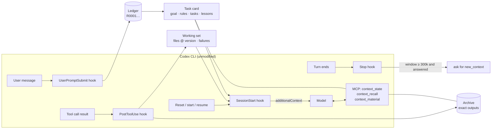

# Design

This document explains why Better Codex Context exists, what it measured, and how each part
works. The [README](../README.md) covers installation and settings.

The core method is **shadow context replacement**. Next to Codex's real context window the
plugin keeps a *shadow context*: a mirror of the conversation (user messages, the agent's replies,
one line per tool call), a ledger of every user message, a task card built from it, a working set
of the files in play, and an exact archive of every tool output (the *referenced context*). Hooks
keep the shadow current as the session runs; *sidecar compression* condenses its conversation in a
separate `codex exec` process in the background. When the real window gets heavy, Codex resets it
without a model call and the shadow takes its place. A loop guard and the restoration of cut
`AGENTS.md` rules complete the picture. The conversation mirror, sidecar compression and the
replacement edge cases are specified in [sidecar-compression.md](sidecar-compression.md).

## 1. What was measured

The design starts from 18 real Codex CLI session logs (rollouts under `~/.codex/sessions`,
1.6 GB in total, Codex 0.16x, 258k and 475k context windows). Six of them had more than 1,000
model requests. `scripts/rollout_metrics.py` reproduces every number below from your own logs
and prints aggregates only, never message text.

**Requests get slower as the window fills.** Time per request grew roughly linearly with the
tokens in the window:

| Tokens in window | Seconds per request (three heavy sessions) |
| --- | --- |
| 0–50k | 5.6 · 7.5 · 5.6 |
| 100–150k | 7.5 · 11.8 · 11.6 |
| 200–250k | 10.6 · 18.7 · 14.4 |
| 300–350k | 15.1 · 20.9 · 20.1 |
| above 400k | 21.3 · 25.5 · 25.7 |

Rough fit: `seconds ≈ 5 + 0.045 × (thousands of tokens)`. Prompt caching hit 97–99%, so cost
was not the main problem; caching does not remove the compute on a long sequence. Native
compaction fired at about 95% of the window (about 450k of 475k), so in heavy sessions 42–86%
of all requests were sent with more than half of the window filled.

**Compaction keeps the wrong things and the floor keeps rising.** After a compaction Codex keeps
every user message verbatim plus an opaque summary. In one session the last compaction kept 339
user messages, including 28 screenshots (about 10 MB of base64), 7 exact duplicates, 17
messages injected by automation and 76 replies shorter than 15 characters, with no
done or cancelled markers. The window size right after compaction (the floor) climbed from
20–37k to 49–89k over a session.

**Goals and rules get lost.** Hundreds of flat messages carry equal weight, so the model
re-decides on every request what is done, what was withdrawn and what is a standing rule.
Users repeat rules ("always reproduce in the browser before fixing"), and fixed bugs come back.
6–16% of user messages were corrections. Separately, one project's 98 KB `AGENTS.md` was cut at
the default `project_doc_max_bytes` of 32 KiB, so 51 of its 60 sections never reached the model.

**Work is redone after every compaction.** Of the file reads between a compaction and the next
edit, 41–72% were files the session had already read before the compaction, and 6–33% of all
shell commands were exact repeats of an earlier command.

**Long output is gone for good.** Codex caps each tool output at about 12k tokens. One session
truncated 465 outputs, hiding about 37.8M tokens that could only be recovered by rerunning.

Task length decides when a reset is safe. Over 519 measured tasks, the window grew by more than
about 165k tokens during 18% of tasks, and by more than about 400k during only 4%.

## 2. Principles

1. **Replace, don't summarize.** What an agent must remember is small; what it must be able to
   look up is large. Keep the first in front of the model and the second in an archive.
2. **Small, structured state survives a reset; everything else is archived, not deleted.**
   The state that matters fits in a few thousand tokens if it is classified: the goal, standing
   rules, open tasks, lessons, the current focus and the files in play.
3. **Resets must be cheap.** A reset that calls the model for a summary costs a slow request
   and produces text nobody can inspect. Codex's TokenBudget mode resets the same thread without
   a model call; the plugin supplies the state to restore.
4. **Never lose a user's words.** Classification decides where a message appears on the card,
   never whether it is kept. Every paragraph keeps an id and stays recallable verbatim.
5. **Plugin interfaces only.** Hooks, an MCP server, a skill and Codex's public config API.
   No patched binary, no proxy, no rewritten session files.

## 3. Components

All state lives in `<project>/.better-codex-context/` (SQLite plus content-addressed object
files; a nested `.gitignore` keeps it out of Git). If the project directory is not writable it
falls back to `~/.local/state/better-codex-context/workspaces/<hash>/`. Each Codex session and
sub-agent has its own scope inside it.

### Ledger and classification (`requirements.py`, `classify.py`, `card.py`)

`UserPromptSubmit` stores the message verbatim and splits it into paragraphs; each paragraph
gets an id `R0001, R0002, …`. A deterministic classifier (no model call) sorts it:

| Class | Rule | Effect |
| --- | --- | --- |
| automated | `<environment_context>`, hook output, bot notices | archived only |
| ack | the whole message is "ok", "continue", "好", "收到" … | archived only |
| duplicate | identical to an earlier message | attached to the earlier item, repeat counted, item reopened |
| constraint | "always / never / from now on / 以后都 / 每次 / 禁止 …", not phrased as a question | standing constraint `C…`, identical rules merged |
| correction | "still broken / that's wrong / 不对 / 又出现 …" | task `T…` linked to the task most recently worked on |
| task | anything else | task `T…` |

Messages sent while a turn is still running reach the hook with the same turn id; each gets its
own key so none is dropped. When a message repeats, corrects or adds a rule, the hook adds one
short line of context ("The user repeated an earlier request (T4)…").

### Task card (`card.py`)

The card is the durable state of the task. The model updates it once per turn with one batch
call, `context_state(action="card", ops=[...])`: `set` status, `add` task/constraint/lesson,
`merge`, `move`, `goal`, `checkpoint` (focus, next steps, summary). Completing a task needs a
verification note; withdrawing a user request needs a later user message as authorization.
A failing op names itself and nothing in the batch is applied.

The card has a hard token budget and degrades in fixed steps instead of failing: closed items
collapse to id ranges, the older backlog is summarized, and in the last step only id ranges
remain. Every R id is always listed, at least as part of a range. Standing constraints are the
last to lose their words: tasks and lessons collapse to ids first, and constraints keep at least
120 characters until the final step. A guard at every restore checks that each active constraint
appears in words; any that the card could only list by id go into a separate
`standing-constraints` segment, and the restore line in the terminal says so.

### Scoped constraints (`scopes.py`)

Preserving a rule is not the same as applying it. A constraint can carry `paths` (workspace
globs, set by the model with `{op: "set", id: "C2", paths: ["src/trading/**"]}`), and path words
in its own text count as scope too: a directory path such as `src/trading/` or a file name with a
known extension such as `scale.ts`. After every tool call that changes files (parsed like the
working set: `apply_patch`, redirections, `sed -i`, writers), each changed file is matched against
the active constraints; a hit adds a `[constraint check]` note naming the file, the rule and its
ledger ids, and asks the model to check the change before finishing or stop and tell the user.
Each (constraint, file) pair is reminded once per turn. Matching is deterministic and the check
reminds instead of blocking: a plugin cannot judge whether an edit complies, and a wrong block
would stall the work. Constraints without any path apply everywhere and head the card.

### Plan mode (`plans.py`, `requirements.record_answers`)

Codex's plan mode explores read-only, asks its questions through `request_user_input` and ends with
one `<proposed_plan>` block, a complete replacement of any earlier one. Its instructions are part of
the context Codex rebuilds for every window, so a zero-model reset keeps the session in plan mode,
and `new_context` is an ordinary tool call inside the turn (plan mode only refuses automatic
turns). Hooks cannot see the mode (`permission_mode` is only default or bypassPermissions), so the
plugin keys on the artifacts instead:

* the `<proposed_plan>` block, read from the final answer at Stop and from the session log, is kept
  word for word as the plan of record (`P1`, `P2` …, deduplicated by content); every fresh window
  restores the latest one in a `plan` segment within `plan_budget` tokens (a longer plan from its
  beginning, the rest one `context_recall(ref="P2")` away), and the shadow body references it as
  `⟦P2⟧`; the segment asks the implementation to follow it, to give the reason for any deviation in
  the change note and to check the plan's tests before declaring the work done;
* the user's answers to `request_user_input` reach Codex as a tool result, not as a message. The
  PostToolUse hook turns each answered question into a ledger paragraph `Decision: question →
  answer`, filed as a standing constraint (`card.ingest(..., forced="constraint")`), so the choices
  that shaped the plan are restored in full after every reset.

### Task statuses (`card.start_turn_tasks`, `card.stale_turn_tasks`)

The card's statuses are the model's statements, with two checks from the hooks. When a turn makes
its first real tool call (the plugin's own card and recall tools do not count), the tasks its user
messages created or reopened move from `pending` to `in_progress` through the card's ordinary `set`
operation; that is a fact, not a judgement. A turn that did work but never updated the card itself
(`hook_turns.carded`) is not held when it ends: with the user's next message the model is asked once
to set the statuses of the tasks it left in progress (`card.followups`, `hook_turns.followed_up`).
A finished turn is never held to add anything; the end-of-turn replacement is the one continuation.
`done` still needs a verification note and withdrawing a user request still needs a later user
message. `card_updates = "off"` turns the follow-up off.

### Change notes (`changes.py`)

A replaced window keeps the conversation and excerpts, not each diff and the reasoning behind it,
yet what a later window most needs about a change is its purpose. Right after each change, in its
next message while it works (not collected at the end of the answer), Codex writes a change note in
plain markdown, a title line ``**BCC Change note** · T# · `path` `` followed by four bullets: motive,
reason, risk and tests (needed, done or none). Markdown, because the Codex terminal prints HTML-like
tags verbatim (the earlier `<bcc-change files="…" task="T#">` tag looked raw); that tag is still
read. The instruction is part of the TokenBudget guidance message, present in every window, and of
the bundled skill. The plugin captures the block from assistant messages in the session log at every
tool call (shadow sync), announcing a new note in that tool call's activity line so the user sees it
during the turn, and from Stop's `last_assistant_message`; it stores each once as `K1`, `K2` …
(deduplicated by content), and:

* restores a `change-notes` segment in every fresh window, newest notes in full within
  `change_notes_budget` tokens and older ones as id ranges;
* replaces the block in the shadow body with `⟦K3⟧ change note: <files> (task T3)`;
* marks edited files in the working set with their newest note (`why: K3`);
* resolves `context_recall(ref="K3")` to the note.

With `change_notes = "require"` (default), the first tool call of a turn that changes files (parsed
like the working set) gets a one-line reminder to end the turn's answer with a change note
(`hooks.edit_reminders`, once per turn: `hook_turns.reminded`). The finished turn is never held for a
missing note: written after the turn, on request, it would be worth little.

Code comments work the same way, while the code is written. The guidance tells Codex to comment
non-obvious code (why, constraints, invariants, edge cases), not line by line; with
`code_comments = "require"` (default) each patch of the turn is read as it lands, counting, per code file, added code lines and
added comment lines by the file type's syntax (`#` and docstrings, `//` and `/* */`, `--`, `<!-- -->`;
other file types are not checked). A file that gained `comment_min_lines` (12) or more code lines
without one comment line gets the reminder, once per turn. Edits made through shell commands are
not analyzed.

### Protected reference documents (`protected.py`)

A fresh window cannot carry every document the agent once read, and should not; what must survive
is the knowledge that a governing document exists, which version the agent last read, and where
that read is archived. A document is protected when the model marks it on the card (`protect` /
`unprotect`, exact workspace paths) or automatically the first time the agent reads a file whose
name says it is an architecture, design, ADR, contract, specification or invariants document.
Every restored window gets a `protected-references` segment, one line per document (at most 12)
with its live state against the version last seen (unchanged, changed, not read, missing) and the
archived read for an unchanged one; the content itself is never injected. On each user message, a
protected document that changed since it was last read is reported once per version, and one the
message names (path, file name or a distinctive stem) is flagged when its current version was not
read. `bcc verify` reports protected documents that disappeared.

### Integrity checks (`verify.py`)

`bcc verify --session ID` checks one session's invariants and reports ok, warn or fail for each:
SQLite integrity; every user message in Codex's session log since recording began is in the ledger
(image tags the log adds are ignored; messages before the plugin was installed are counted
separately); ledger paragraphs and merges point at existing card items, and task, rule and
correction paragraphs are on the card; every active constraint reaches a fresh window in words;
every archived original the ledger, card and shadow refer to is readable and matches its hash;
hook failures logged for the session and turns without a Stop beyond the interruptions in the log.
The exit code is 1 when an invariant is broken.

### Working set (`workset.py`)

Built from tool results without model effort: which files were read or edited (parsed from
`cat`, `sed -n`, `nl`, `head`, `tail`, `apply_patch` …, ignoring heredoc bodies), the content
hash at that time, commands that still fail, and outputs the host truncated. On restore, a file
whose current hash still matches is marked *unchanged since last seen*, so conclusions already
on the card need no re-reading.

### Archive and recall (`store.py`, `materials.py`)

Every tool result the host reports is stored once, content-addressed and integrity-checked
(16 MiB per object). `context_recall` reads it back in pages (4,000 characters by default,
16,000 at most) or searches by `query`. A search splits the query into words that must all
occur (case-insensitive) and first returns ranked matches from the requirement ledger and the task
card (more occurrences first, then the newest), searched in the database, so thousands of
paragraphs stay searchable; archived originals are searched after that. `ref` accepts an archive id, a requirement id (`R0009`),
a card item (`T3`, `C2`, `L1`) or an event key and opens the original message behind it.
`bcc capture -- CMD` runs a verbose command, archives the full output and returns a short
excerpt with error lines, which avoids the host's 12k-token cut.

### Resets (`native_budget.py`, `hooks.py`)

With `features.token_budget.enabled`, Codex's automatic compaction becomes a reset of the same
thread that rebuilds the system and tool prefix and calls no model. It also gives the model a
`new_context` tool. `bcc activate` writes these settings through Codex's config API and replaces
Codex's built-in guidance texts, which mention `notes`/`history` tools that Codex does not
expose, with texts that point at the task card.

After every reset Codex fires `SessionStart(source="compact")`. The plugin answers with the card,
the working set and, if the reset cut a turn in half, the user's request that was being handled. At
the end, right before the line that says what to do now (continue the request, or reply `Context
refreshed.`), comes a fixed reminder, `ATTENTION! ATTENTION! ATTENTION!`, to analyze the root cause
and the path of a problem before writing code instead of patching symptoms, to replace or delete
inefficient, redundant or piled-up code rather than append (instead of growing the line count), and
to choose lean, efficient algorithms, frameworks and solutions (the most economical design that
fully removes the root cause, without trading away correctness; a change that fits an existing
abstraction layer plugs into it instead of opening a separate branch path), and, unless asked, to
write no branches or fallbacks for cases that can never happen: a fresh window has lost the
investigation behind the current code, which is when surface patches and needless machinery pile up.
It is the last thing the model reads before it acts; the bundled skill opens with the full
engineering discipline it summarizes (root cause before code, replace rather than pile on, respect
the existing architecture, no speculative engineering, the simplest complete solution, verify the
fix, break unproductive loops, keep decisions across resets, a self-check before completion), so the
two sit at opposite ends. The reset dropped every earlier injection, so nothing accumulates.

There are two thresholds:

A *turn* is one user message and everything Codex does until it answers; a task usually spans
many turns.

* **While a turn runs: 440k** (`model_auto_compact_token_limit`; every install sets it and marks it with a
  bilingual `BCC-MANAGED` comment; deleting that marker keeps the user's own value from then on), a safety net. Over the 519 measured
  turns this limit resets only about 4% mid-way (10% at 300k, 18% at 200k); 24k tokens before it,
  Codex reminds the model to save a checkpoint, and the request in progress comes back with the card.
* **When a turn ends: 300k** (`idle_reset_tokens`), the main replacement. When a turn ends,
  the Stop hook reads the latest token count and the model's window from the session log. If the
  answer is complete and the window holds at least 300k (63% of the model's window when that is
  smaller than 475k), it blocks the stop once with a reminder; the model updates the
  card and calls `new_context`, then replies with a single line. Codex marks the following Stop
  with `stop_hook_active`, so this never loops. Above the in-task limit the hook does nothing
  because the native reset before the next request is free anyway.

The cost is one or two extra, mostly cached requests at the end of a large turn. In return the
next turn starts at about 30–40k tokens instead of where the last one ended.

The plugin depends on Codex interfaces that are still marked experimental, so it watches for
signs that they changed: after a reset it reads the `compacted` record Codex wrote, and if it holds
a model-written `compaction` item (Codex fell back to its own compaction) the terminal says so;
at the start of a session on a Codex version newer than every verified one, it says that too.

### Instructions Codex cannot load (`instructions.py`)

Codex concatenates the `AGENTS.md` files from the repository root down to the working directory
and keeps only the first `project_doc_max_bytes` (32 KiB by default), often cutting mid-sentence.
At every session start and after every reset the plugin finds the cut part, archives each cut
section, and injects a budgeted block (`instructions_budget`, 2,000 tokens by default): the
rule-like lines from the cut part (must, never, always, 必须, 禁止 …; emphasized lines first,
picked round-robin so every section is represented) and an index of the cut sections with the
archive id to read each one in full. On the 98 KB file from §1 this restores 19 of 83 rules and
indexes all 52 cut sections in about 1,900 tokens. The files themselves are never changed.

### Skills (`skills.py`)

Across a replacement Codex rebuilds its skill list (names, descriptions, paths; checked over 18
replacements of one session: no entry dropped or shortened) but not the SKILL.md text the model
read. Re-reads degrade too: Codex cuts long output and keeps its head and tail, and in recent
sessions 5 of 7 skill reads were cut, the plugin's own skill among them. A partial skill reads
like the whole one, so the plugin never lets one pass silently:

- Resident skills (`resident_skills`, default `context-discipline`) go word for word into every
  new window (startup, `/clear`, replacement; not resume, whose window Codex rebuilds from its
  log), first, as the most stable part. They are never shortened: the shadow's cap is reduced by
  their size instead, and their earlier reads show only a pointer to that segment.
- Any other skill read leaves no excerpt and no evidence summary in the shadow, only the note
  that its text is not kept and must be read again in full before use.
- PostToolUse compares a skill read with the file: twelve lines spread over it, and its last
  line, must be in the output. If any is missing (an output limit or a ranged read), Codex is told
  at once to read the rest before following the skill.

### Loop guard (`loops.py`, `loop_signals.py`)

Hooks get no exit codes from Codex, so everything comes from the output, and everything is
computed once when a tool result is archived (kept in the event's metadata), so the check itself
never re-reads large outputs. No model is called.

* **Command keys.** Plain, known test invocations share a key: `pytest -q`, `python -m pytest -q`
  and `python3 -m pytest -q` are one command; `npm test`, `npm run test`, `pnpm test` and
  `yarn test` are one; `npx vitest` is `vitest`. Arguments stay in order, so different test paths
  stay different. Anything with pipes, redirections, variables, environment assignments or several
  commands keeps its literal text.
* **Failure fingerprints.** pytest `FAILED`/`ERROR` lines, TypeScript `error TSxxxx` lines, Jest and
  Vitest failing tests, else the last exception of a traceback; line numbers, timings, addresses,
  clock times and temporary paths are dropped, asserted values are kept (so `30 != 10` becoming
  `20 != 10` is a different failure). Unparseable output falls back to the error-line signature.
* **Progress.** pytest, Jest and Vitest summaries give passed and failed counts and the failing
  tests. Fewer failures, more passes or a smaller failing set between two runs is progress.
* **Code oscillation.** Each edit keeps the file's content hash (`file_versions`, hashes only, with
  the version last seen before the first edit as the starting point); a file that went back to an
  earlier version (A → B → A) during a failing streak is named in the note.

**stuck**: the same command key failed with the same fingerprint run after run, files changed in
between, and no run improved on the one before; a pass, a different failure or progress ends the
streak. Runs whose output the host truncated are not comparable: they neither count nor end it.
User messages that only correct, acknowledge or repeat keep the streak; a message that starts a new
task begins a new one. With `loop_guard` = N (3 by default) the note rises in three levels and is
not repeated in between: a **warning** at N−1 runs (from 2: check that the fix addresses the cause),
**rethink** at N (the approach is not working; re-examine the root cause, compare what was tried,
verify differently, record the rejected approach as a lesson) and **escalate** at N+2 and every N+2
after (stop patching in the same direction, question assumptions and the design, record verified
lessons, tell the user what blocks). Oscillating edits raise a warning to rethink.

**repeat**: the same command returned identical output N times with nothing edited in between since
the user's last message, unless that message asked for repetition ("run it 5 times", "keep checking
until …"). Commands that only look at things (`cat`, `sed`, `rg`, `git` …) can only be repeats.

The guard never blocks, rolls back or edits anything, and a detector error is logged and ignored.
Replayed over 27,336 real tool calls from 12 long sessions, the guard spoke 7 times: 4 warnings and
1 rethink on genuine fix-and-retry loops (the same contract error after every fix; the same network,
401 and port errors after changes) and 2 repeats while polling unchanged output. The previous
version spoke 3 times on the same data. Oscillation and test progress need the live files and test
summaries of a session and are covered by unit tests. One check over a 200-event window takes
about 3 ms (p95 under 4 ms). What it still cannot recognize: loops that alternate between different
commands or different errors, a fix that moves the failure to another test each time, failures of
tools whose output is not test or traceback shaped, and anything inside output the host truncated.

### Supervisor (`supervisor.py`, off by default)

A second model watches the shadow context for drift from what the user asked. It was designed against a replay of
82 real sessions (33 on one machine, 49 on another; 2,061 user requests): rule triggers alone hardly predict a later
user correction (precision 5–18% against a 9–12% base rate), so they only pick the moments, and models decide.

- **Triggers** (once per user request mid-turn, once per turn at its end): the work spreads over 8+ files or 2+ new
  ones; 25 tool actions without a change; the same command three times; 15 minutes since the request; a turn end
  that asks the user, claims success after edits, or stops while its own work is open (including a turn another
  Codex task's message started and a bare acknowledgement ended).
- **Screen** (GPT-6 Luna, max): a filter, not a judge. It passes a moment only when it can quote the line its doubt
  rests on, and marks the line ranges (also those that may speak for the agent). A wide screen passed 70–80% of the
  moments; the strict one passes 22 of 48.
- **Judgement** (GPT-6.1 Sol, xhigh): an excerpt (the task card, every user message; since the latest one every agent
  message and each action as one short line; the marked ranges; the last 15 lines), never the screen's conclusion.
  The first excerpt (without the agent's words and actions since the request) cut the judge's input from 14.6k to
  1.7k tokens and the cost per judgement by half, but lost three of nine findings: twice the drift sat in lines the
  screen had not marked, once the judge let "再补一道边界" pass. Hence the agent's own words and actions in every
  excerpt, the words that give guarding and substitutes away in the standard, and a second look: a judge unsure on
  the excerpt judges once more on the whole material. On the same 48 moments this version found 9 (8 of the 9 the
  whole-transcript judge found, and one it missed) for $0.029 per judgement (whole transcript: $0.052), with 22 of 48
  moments passed by the screen and no second look needed. The one it let pass is debatable: a rollback in a one-click
  upgrade script.
  The judge never sees the screen's conclusion: given it in a first version, it agreed with the screen 10 times out of 11. It stands
  where the user stands (the user's goal before the current step; the simple path; the feature first; no guarding
  against impossible cases) and says off_track only with quotes. For a question to the user it gives the answer
  when the user's words, rules or the agent's own recommendation settle it.
- **Open tasks**: a turn that ends with tasks still open on the card (pending, in_progress, needs_verification,
  blocked) is reviewed in both modes: the screen checks each against the transcript (done but not ticked, cancelled or
  replaced, waiting on the user) and passes only work that remains and could go on now; the judge then returns the
  unfinished tasks with what is left, numbered restart steps and a restart prompt that answers why the agent stopped.
  The same set of open tasks is reviewed at most twice (`OPEN_TASK_REVIEWS`); progress makes a new set. It runs before
  the question and claim checks, since it also checks a question at the end (is its answer known?) and a claim against
  each task: a question reviewed alone left the open tasks unseen, as when a real session's "是否要求…" (whether it
  requires …) was read as a question and its early stop passed. A wait counts only when it is real now: a window
  another task asked for (a few minutes, hours ago), another task's run or a resource state is something the agent can
  check itself, so an unchecked wait is restarted with that check first, then the work (low priority, one run at a
  time) or an explicit arrangement with the other task. Messages from parallel tasks can look like the user's, and a
  window such a task asked for is not taken for one only the user can give. With the real models on a staged early stop
  (backend done, "the frontend and the acceptance next round, shall I go on?"), Luna passed it and Sol returned the
  unfinished task, three restart steps (find the page, the full test run, the page acceptance) and a restart prompt in
  70 s; a real session on the macOS daemon woke from `codex queue` within a second and its message was filed as
  automated.
- **Delivery**: `advise` runs reviews in a detached worker (like evidence summaries) and delivers a finding at the
  next tool call or user message. `auto` does the same mid-turn. At a turn end, when the session runs in the local
  app-server daemon (its control socket lists the thread in `thread/loaded/list`), the turn ends at once, the review
  runs in the worker, and a finding wakes Codex: `codex queue --thread <session> --message "[BCC supervisor] …"
  --resume` starts a turn with it, or right after the running one (checked with a synthetic model: an idle session
  woke in 3.5 s; a message queued during a turn ran right after it). Codex shows the message as a user message, so the
  plugin files it as an automation notice and the shadow labels it `[supervisor]`. Where the session cannot be woken
  (Windows has no socket; VS Code runs its own app-server) the Stop hook reviews (its timeout is 480 s; the hook's own
  deadline is extended only then) and continues the turn with the finding, once per turn end (`stop_hook_active`).
- **What it found**: in one session it flagged an over-built fix (backups, clipboard checks, new modules and docs for
  "clear the input box") at every trigger from 13 minutes before the user objected; at turn ends it named open work
  ("approval pending does not stop the source work") about half of the times the user later had to push the agent
  on, and as often where the user did not push. Cost per review: Luna about $0.003, Sol about $0.03.

What the user sees: every step of the supervisor (on, reviewing, its finding, an answer it gave, a review that found
nothing or failed) is one small block: a title whose status word carries the severity colour (green fine, cyan at
work, yellow a warning, red serious: off track with confidence 0.8 or more, or drift from the request, or a false
completion), then a three-row eye with grey labels and white text beside it. A background review that clears the work
ends visibly too: on the Mac mini its first real review (a session reporting another session's upgrade) passed the
screen and was cleared by the judge, and only a "reviewing" line had been printed. What Codex hears is only a finding;
the guidance makes it binding: the supervisor manages the session for the user, and only the user's own explicit
words rank above it.

Peer messages (`<codex_delegation>`) enter the shadow as `[other Codex task]` lines, so they survive resets; they
never enter the ledger, and the guidance treats them as a peer's report, never as the user's words.

A peer can also reach a session as a plain user message: `send_message_to_thread` and `codex queue` deliver it
through the queue, or steer it into a running turn, and the log records it with the user's own provenance. What
tells it apart is the message id the sending client set (`clientUserMessageId`, logged as the UserMessage item's
`client_id`): a Codex client (the CLI, the VS Code extension, the desktop app) sets a random UUID (version 4), the
queue its item id (version 7), and a steer from another task none. Over 1,500+ messages of real sessions on two
machines there was no exception; the turn trigger (`queue`) is no sign, since VS Code queues a message typed during a
turn too, and a `codex exec` prompt has no id and is still the user's (turn trigger `exec`). The id is logged only
after the prompt hook has filed the message, so the shadow sync corrects it (`shadow._origin`, `card.from_peer`): the
line becomes `[other Codex task]`, the paragraphs leave the user's requests (class `peer`), and an open item only that
message created is withdrawn. On the Mac mini, a worker session's card had 63 open tasks, most of them a
coordinating session's status reports and window requests, so nearly every turn end started an open-task review.

### Activity log (`activity.py`)

Every action the plugin takes is reported, as it happens, as one short English line on the hook
run in the Codex UI (`↳ Hook · BCC · …`), with the specifics as indented detail lines: where each paragraph of a
message landed on the card, which files and failures entered the working set, what a card update
changed, what was restored after a reset (including cut `AGENTS.md` rules), when the loop guard
stepped in, and why an end-of-turn reset was requested. The lines
use "organize" and "optimize"; nothing is described as compressed, because nothing is thrown
away. The Codex CLI prints every line of a hook message (its hook cell, `hook_cell.rs`, has no
"Show details" fold, unlike command cells), so `normal` keeps routine tool results to one line each
(an edit recorded, a failing command with its error line, a long output archived and indexed;
lines say what the plugin did, not what Codex left out), skips the detail
of a one-paragraph message and of a change note already visible in the answer, and leaves the rest
to `verbose` (also every archived tool result). `activity_log` selects `normal`, `verbose` or `off`.

### Hook reliability (`hookrun.py`)

Codex shows only "hook exited with code 1" for a failing hook and drops its stderr. So hooks
always exit 0; a failure returns a `systemMessage` (shown as a warning on that hook run) with the
exception and location, and the full traceback goes to
`~/.local/state/better-codex-context/hook-errors.log`. A hook that runs longer than 4 seconds
reports where it was stuck before Codex kills it at 5 seconds. `PostToolUse` reports the tool's
working directory rather than the session root, so the session root is remembered from the other
events and, failing that, read from the session log's first line.

### Settings through Codex (`settings.py`)

Every setting has a description in `settings.DESCRIPTIONS`, the single source for what it does.
`context_state(action="settings")` returns each setting with its value, default, source (default,
config file or `BCC_<NAME>` environment variable) and allowed values; with `set` it validates the
values against the same ranges and choices that `load()` uses, writes the config file (keeping the
user's other lines, dropping a key that returns to its default) and reports an environment variable
that still overrides it. The MCP server runs outside Codex's sandbox, so Codex can make the change
the user asks for even though the file lies outside the workspace. Threshold lines in the terminal
say when a value is not the default and where it comes from.

### Installation and upgrades (`packaging.py`, `upgrade.py`)

A locally installed plugin gets no variable expansion in its MCP and hook commands, and
`codex plugin add` deletes the previous cache directory. `bcc install` therefore builds a
versioned directory `dist/better-codex-context-<version>` whose commands use absolute paths to
itself and to the Python that built it, registers it as the `mathline-research` marketplace ("Mathline Research"; an install under the earlier name
`mathline-context` is removed first, so the hooks never run twice),
installs it, checks that exactly the four expected hook commands are present before trusting
them, applies the settings, and asks the running Codex daemon to reload its configuration so
open sessions pick up the new hooks. IDE windows that run their own Codex over stdio cannot be
reached from outside and need a window reload.

Without `--codex`, the install covers every Codex on the machine (`codex_targets`): the CLI on
`PATH` and the newest Codex bundled with each VS Code install (`~/.vscode`, `~/.vscode-server`,
`~/.vscode-insiders`, `extensions/openai.chatgpt-*/bin/*/codex`). They share `~/.codex`, so the
first does the full install; each further one must list the same four hooks (or adds the plugin
itself), trusts them and writes the settings through its own config API, which validates them for
its own version. The CLI (0.167) and the extension's Codex (0.164) compute the same hook hashes, so
one trust entry serves both. Sidecar compression resolves its Codex the same way on every run
(`find_codex`), so an extension update that moves the bundled binary needs no setting.

The extension shows hook messages in a "Hook stats" dialog per answer, as plain text, and prints
ANSI codes verbatim, so its lines go out uncoloured. The hook decides from the Codex process that
runs it: when the extension's bundled Codex (`/openai.chatgpt-` in its path) is among the hook's
ancestors in `/proc`, the lines are plain. The session log is not used for this: its
`session_meta.originator` names the client that created the session, so a VS Code session resumed
in the terminal would wrongly lose its colours.

### Platforms (`util.py`)

The same code runs on Linux, macOS and Windows; the few POSIX-only calls branch in `util.py`. Every
plugin process runs Python in UTF-8 mode (`-X utf8`), because Windows Python otherwise reads and
writes text in the locale code page. Codex runs hook commands through the session's shell (sh, bash
or zsh on Linux and macOS; PowerShell on Windows), so the hook command and the `capture_command_prefix`
are quoted for it: on Windows with PowerShell's call operator (`& 'path' 'arg'`), since a quoted path
alone is only a string there and the hook would silently never run. The hook deadline is a watchdog thread that interrupts the
main thread (a real SIGALRM where threads can be signalled, `interrupt_main` on Windows); the session
lock is `fcntl.flock` or `msvcrt.locking`; the sidecar worker is detached with a new session or
`DETACHED_PROCESS` and stopped with `killpg` or `taskkill /T`; its liveness check never uses
`os.kill(pid, 0)` on Windows, where that call terminates the process. Safe file reads walk directory
descriptors on POSIX and check each step for links and junctions on Windows. VS Code is recognised by
`CODEX_INTERNAL_ORIGINATOR_OVERRIDE=codex_vscode`, which the extension sets when it starts its Codex
and Codex passes on to every hook. Windows has no Unix control socket, so `install` cannot reload a
running Codex there.

## 4. What the plugin does not do

* It does not modify Codex, its binary or bundled files, and it does not rewrite session logs.
* It does not run commands through MCP; `bcc capture` runs under the caller's own sandbox.
* It sends nothing over the network itself. Sidecar compression (the shadow conversation) and evidence
  summaries (large tool outputs and screenshots, `evidence.py`) go through `codex exec` to your own
  Codex account, the service Codex itself uses.
* It does not ask for approval for its own state. The MCP tools declare annotations:
  `context_recall` is read-only, `context_state` is neither destructive nor open-world (it writes
  only the plugin's state in the workspace), so Codex runs both without a prompt, also under
  `approval_policy = "never"`, which rejected them while they declared nothing. `context_material`
  works on local state only and runs without a prompt too.
* It does not decide when a task is done; the model does, and must say what it verified.
* It does not block tool calls. Constraint checks remind the model after an edit; whether the
  change complies is the model's judgement, and the user's when the model says it cannot comply.
